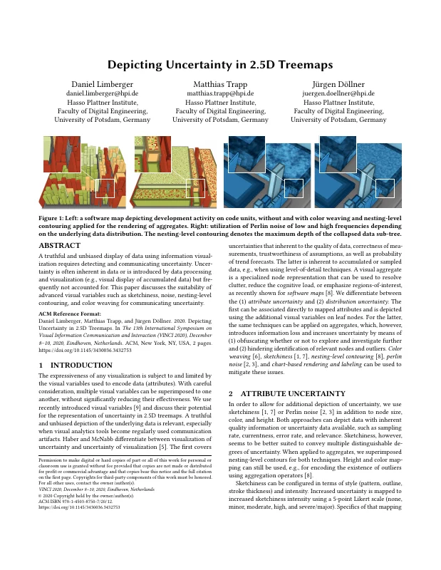
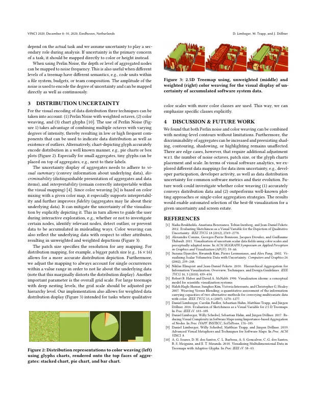

# Depicting Uncertainty in 2.5D Treemaps

[Daniel Limberger](https://orcid.org/0000-0002-9111-4809), [Matthias Trapp](https://orcid.org/0000-0003-3861-5759), and [Jürgen Döllner](https://orcid.org/0000-0002-8981-8583)

*Proceedings of the 13th International Symposium on Visual Information Communication and Interaction (VINCI '20)*, December 8–10, 2020, Eindhoven, Netherlands. ACM, pp. 28:1–2.

[](https://doi.org/10.1145/3430036.3432753) [](https://doi.org/10.5281/zenodo.24056633) · [ResearchGate](https://www.researchgate.net/publication/347313642)

> A truthful and unbiased display of data using information visualization requires detecting and communicating uncertainty.
> Uncertainty is often inherent in data or is introduced by data processing and visualization (e.g., visual display of accumulated data) but frequently not accounted for.
> This paper discusses the suitability of advanced visual variables such as sketchiness, noise, nesting-level contouring, and color weaving for communicating uncertainty.

<p><a href="limberger2020-uncertainty-as-submitted.pdf"></a> <a href="limberger2020-uncertainty-as-submitted.pdf"></a></p>

## Contents

- [`src/`](src/) – LaTeX sources of the camera-ready version (ACM `acmart` v1.71, sigconf)
- [`limberger2020-uncertainty-as-submitted.pdf`](limberger2020-uncertainty-as-submitted.pdf) – camera-ready PDF as submitted to ACM
- [`slides/`](slides/) – LaTeX (beamer) sources of the VINCI 2020 talk
- [`limberger2020-uncertainty-slides.pdf`](limberger2020-uncertainty-slides.pdf) – talk slides as presented
- [`build.sh`](build.sh) – reproducible build with TeX Live 2020 (podman or docker)
- [`preview/`](preview/) – page previews for this README

## Build

```bash
./build.sh        # → build/article.vinci-uncertainty.pdf
./build.sh slides # → build/slides/color-weaving.pdf
```

The build uses the bundled `acmart.cls` (v1.71, 2020) and the TeX Live 2020 container; a local TeX Live 2026 (`latexmk -pdf src/article.vinci-uncertainty.tex`) gives the same result.
On `main`, the build produces the revised version (`v1.1-revised`). Check out `v1.0-camera-ready` to reproduce `limberger2020-uncertainty-as-submitted.pdf` (identical text and layout; bold figure captions differ marginally in glyph rendering).
The slides build reproduces `limberger2020-uncertainty-slides.pdf` pixel-identically.

## Versions

- [`v1.0-camera-ready`](https://github.com/dl-archive/article.2020-vinci-uncertainty/tree/v1.0-camera-ready) – sources as submitted to ACM (2020-11-02)
- [`v1.1-revised`](https://github.com/dl-archive/article.2020-vinci-uncertainty/tree/v1.1-revised) – author's revised version (2026-11-08): typo, grammar and reference fixes, see [Revisions](#revisions)

## Revisions

`v1.1-revised` (2026-11-08) corrects errors in the camera-ready version without changing its content.
Every page carries the note "Author's revised version (2026-11-08). Version of record: https://doi.org/10.1145/3430036.3432753".

- Running head: "D. Limbeger" is now "D. Limberger".
- References: [5] now has its venue (Visualization in Scientific Computing, IEEE CS Press, 74–93); [7] "2.5 D" is now "2.5D"; [9] now has pages and DOI (11:1–8, 10.1145/3356422.3356444).
- Grammar and typos: "superimposed onto", "uncertainties inherent to", "regions of interest", "associated directly with", "Perlin noise" (consistent capitalization), "data distribution, three techniques", "low- or high-frequency", "chart-depicting glyphs", "well-known", "allows guiding", "detect outliers", "prevent data from being accumulated", "glyph charts' placement", "screen real estate", "glyph charts" (Figure 2), "2.5D treemap using unweighted" (Figure 3).

## Citation

```bibtex
@InProceedings{limberger2020-uncertainty,
  author    = {Limberger, Daniel and Trapp, Matthias and D{\"o}llner, J{\"u}rgen},
  title     = {Depicting Uncertainty in 2.5D Treemaps},
  booktitle = {Proceedings of the 13th International Symposium on Visual Information Communication and Interaction},
  year      = {2020},
  series    = {VINCI~'20},
  publisher = {ACM},
  articleno = {28:1--2},
  doi       = {10.1145/3430036.3432753},
  isbn      = {978-1-450387-50-7},
  pages     = {28:1--2},
}
```
